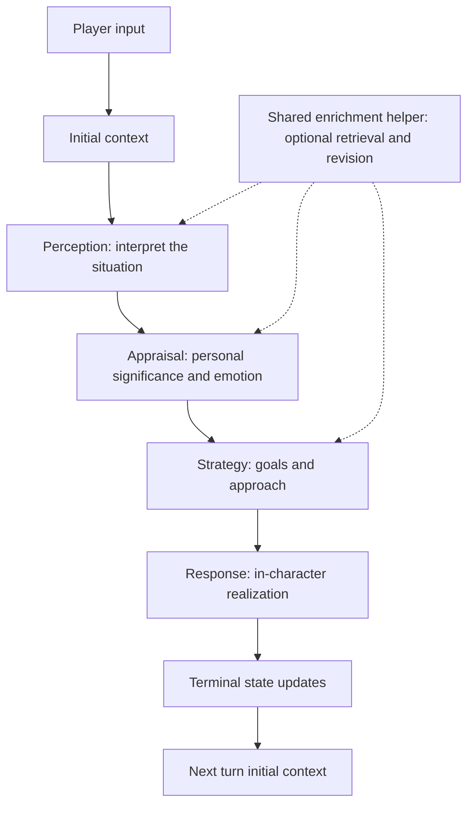

# Cognitive NPC Architecture



Each eligible stage produces a usable draft and evaluates gaps within the same model call.
The stage prompt includes shared strict gap criteria, also supplied as system instructions.
Its JSON extends the cognitive result with `context_request` and `gap_reason` strings.
The request is empty when no recognized material information gap exists. Otherwise it is
one concise string, potentially containing several related questions. The helper submits it
unchanged to one vector query; it never splits questions into separate searches.

`workflow/enrichment.py` contains `GapAnalysis`, `ContextRetriever`, and `ContextEnrichment`.
Stages inherit `EnrichedStage` and supply their prompt builder and cognitive result parser.
The helper validates the draft before considering retrieval. It checks the per-stage limit,
previous requests, fetches evidence, then optionally runs one revision.
There are no standalone gap/retrieval pipeline stages or a special perception loop.

## Boundaries and subjectivity

Perception answers what the NPC thinks is happening. Appraisal assesses what it means to
the NPC and computes emotion. Strategy chooses the response goal, approach and immediate
actions. Response realizes those decisions without retrieval. Initial Context and Terminal
Update retain their existing roles.

All three reasoning stages use the same gap principles. Missing information must be causally
grounded in the original input, current stage goal and NPC profile, and could materially
change this stage's result. An NPC may be confidently wrong or uncertain without retrieval.
The helper does not invent gaps. Shared evidence can reduce redundant requests but does not
guarantee fewer requests in later stages, which may discover new information needs.

Earlier results remain fixed. Contradictory later evidence may produce confusion or emotional
tension; later stages must not rewrite upstream reasoning. Rumors and beliefs retain their
source uncertainty. Strategy action tools record intent only; the final revision replaces
draft actions and only the finalized strategy reaches downstream stages.

## Turn context and bounds

`RetrievedContext` holds initial context, combined evidence text, source records, and an
`EnrichmentDecision` history. Records retain database IDs, metadata, distance and requesting
stage. Source excerpts are shared without a response-focused summary that might discard
facts needed downstream. The existing backend limit of five nearest candidates and its
distance threshold are retained; no new hard token limits are introduced.

The flow allows at most one enrichment backend call and one revision per eligible stage,
with no configurable call limit or helper-level retry. Initial context loading is separate.
Provider transport timeouts remain provider configuration; there is no new total latency SLA.

Equivalent normalized requests are suppressed deterministically, including failed/empty ones.
Prompts require semantic reuse as well. This is conservative matching, not a semantic-search
guarantee: paraphrases may escape suppression. Returning only known evidence IDs causes no
revision. A new question about an already retrieved event remains legitimate if its answer
is absent. Empty/error results preserve the draft. Invalid revision output also preserves it;
invalid initial cognition remains a stage failure.

All shared information is accessible in this iteration. The central filter excludes records
with `type=character` unless `name` matches the current NPC. Other factions' lore remains
accessible. There is no learned-knowledge or faction-membership access model yet.

## Contracts and evaluation

Finalized `PerceptionResult` has exactly `raw_prompt` and `core`; its strict validator enforces
the exact original player text. Core contains situation, interaction type, topic, intent,
player attitude/emotion, and threat/manipulation. Enrichment fields live in history rather
than cognitive outputs. Appraisal and emotion revise together. Other cognitive result
fields remain in `workflow/models.py`; `TurnResult` exposes the shared retrieved context.

Existing traces record stage-owned draft/revision model calls, retrieval evidence and
`context_enrichment` decisions with stage/request/reason.
No-gap, invalid request, duplicate, exhausted budget, failed/empty retrieval, existing evidence,
and successful retrieval/revision are distinguishable.

Roleplay scenarios: `test/enrichment_scenarios.json`. Run the configured model and judge with:

```shell
python -m test.TestRunner --character Tom --suite test/enrichment_scenarios.json --stage "All stages"
```

Stage evaluation uses controlled enrichment evidence by default (empty when absent).
`enrichment_evidence` provides source records or an error; `live_enrichment: true` explicitly
selects the real backend. Scenario notes are judge-only, never injected into NPC reasoning.
The judge evaluates stage-specific necessity, reuse, subjectivity, fixed upstream reasoning
and fallback quality alongside the existing cognitive metrics. Response remains isolated.
